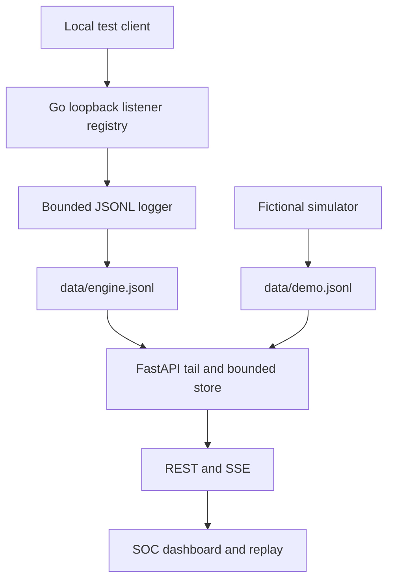

# HoneySpectra

### Multi-Protocol Deception & Threat Intelligence Lab


**[Live Interactive Demo](https://techieengineer.github.io/honeyspectra/)**

Explore the SOC dashboard, synthetic threat telemetry,
protocol analytics and interactive session replay directly
in your browser.

---

**Local multi-protocol telemetry & threat-intelligence research lab**

Go · Python · FastAPI · SSE · JavaScript · Docker

HoneySpectra is a portfolio-oriented systems engineering project demonstrating concurrent protocol adapters, asynchronous event logging, threat classification and a real-time SOC dashboard. It intentionally models suspicious activity with fictional sessions rather than collecting real credentials or handling malware.

> V1 is a local demonstrator, not a production honeypot. Do not publish its service ports or deploy it to a public VPS.

## Highlights

- Configuration-driven registry with six independently enabled adapters; no changes to core routing to enable or disable existing adapters.
- Go goroutines, bounded connection pool, two-second handler deadlines and buffered JSONL with drop/failure counters.
- FastAPI analytics and SSE change notifications, with a bounded 50,000-event in-memory store and a 100-row paginated UI.
- Persistent dark/light theme, protocol distributions, fictional country/ASN and credential statistics, ATT&CK demo tags and safe session replay.
- Harmless fixture SHA-256 values, never live malware hashes; simulator makes no network requests.
- Unit tests, GitHub Actions and optional hardened local container configuration.

## Architecture



## Quick start — Windows PowerShell

Install Go 1.23+ and Python 3.11–3.13. Python 3.13 is used in CI. Git is required for publishing. No database or Node.js required.

```powershell
# From the repository root:
py -3 -m venv .venv
.\.venv\Scripts\python.exe -m pip install -r requirements-dev.txt
go test ./...
.\.venv\Scripts\python.exe -m pytest -q
```

Open three PowerShell windows at the root:

```powershell
# A — dashboard
.\.venv\Scripts\python.exe -m uvicorn backend.app:app --host 127.0.0.1 --port 8000 --limit-concurrency 32
# B — engine
 go run ./cmd/honeypot
# C — synthetic sessions
.\.venv\Scripts\python.exe simulator.py --count 100 --interval 0.25
```

Open http://127.0.0.1:8000. For local engine telemetry only, in another terminal run `Invoke-WebRequest http://127.0.0.1:8081/health`. No simulator or networking is needed to inspect the code. To replay the bundled example dataset instead of generating fresh sessions, copy `docs/sample-events.jsonl` to `data/demo.jsonl` while the simulator is stopped; its historical timestamps will not contribute to the current 60-second rate.

Linux/macOS: use `python3 -m venv .venv` and `.venv/bin/python` instead of the Windows interpreter path; `curl http://127.0.0.1:8081/health` is the equivalent test. Stop each process with Ctrl+C. Stop processes before deleting or archiving local log files.

## Optional containers

```sh
docker compose up --build -d engine dashboard
docker compose --profile demo run --rm demo
docker compose down
```

The engine and demo have `network_mode: none`; the dashboard publishes only host loopback and uses an internal network. Services have non-root users, read-only root filesystems, dropped capabilities and resource limits. Docker networking and volume initialization have not been runtime-tested in this build. Use the native quick start if the local Docker setup fails. `docker compose down -v` additionally deletes the telemetry volume; use only when you want to discard all demo logs.

## Protocols

| Adapter | Local port | V1 fidelity |
|---|---:|---|
| SSH | 2222 | Labelled TCP model, not SSH wire protocol |
| HTTP | 8081 | Minimal HTTP response; route categories only |
| Telnet | 2323 | Labelled TCP model, not Telnet negotiation |
| FTP | 2121 | Labelled TCP model, not FTP commands |
| MySQL | 3307 | Labelled TCP model, not database handshake |
| TCP | 9091 | Generic bounded TCP model |

The `.yaml` file uses JSON syntax, a valid subset of YAML 1.2. Arbitrary YAML syntax is not supported. The engine always binds IPv4 loopback; unknown adapters and duplicate active ports are rejected. Registry extensibility is compile-time for new adapter implementations, runtime configuration for existing adapters (restart required).

## API

| Route | Purpose |
|---|---|
| `/health` | Liveness |
| `/api/summary` | Aggregates over retained events |
| `/api/events` | Protocol filtering, offset/limit pagination |
| `/api/session/{session_id}` | Up to 200 events for one session |
| `/api/stream` | SSE sequence-change notifications |

The dashboard fetches snapshots when SSE notifies it of changes. The backend tails local files about every 250ms and SSE checks for changes every 350ms. Neither zero latency nor 60fps is guaranteed. Session metric means sessions seen in the past 60 seconds, not concurrently connected sockets.

## Safety and known limitations

- No actual credential capture, file uploads, malware acquisition, remote command execution, fake interactive shell or shared VFS. Replay text and credentials are generated fixtures.
- No live GeoIP lookup, webhook delivery, HTTPS, full protocol handshakes, global map or per-IP rate limiter. Fictional geography and ASNs are not attribution; the test IPs use RFC 5737 documentation space.
- ATT&CK identifiers classify explicitly synthetic scenarios only, not confirmed compromises.
- Dashboard lacks authentication. Local processes/users can access its data. Do not expose it to external networks.
- Log files are append-only and not automatically rotated; manually manage retention. Logger overflow can drop events; failures are counted, not retried. No persistence beyond JSONL, no deduplication after log replacement, and no benchmark for 50,000 records or claimed 60fps.
- Container configuration is supplied but has not been executed in the build environment. No production security audit or VPS deployment has been performed.

## Repository guide

- `cmd/honeypot/` — listener lifecycle and concurrency
- `internal/config/` — configuration parsing and validation
- `internal/logger/` — bounded structured logger
- `internal/protocols/` — adapter interface and local models
- `backend/` — analytics, SSE, dashboard assets
- `simulator.py` — fictional event generation
- `tests/` — Python tests; Go tests live alongside packages
- `docs/THREAT_REPORT.md` — analyst report template
- `CONTINUATION.md` — future development handover

## Development roadmap

Improve input-schema validation, log retention, indexing, end-to-end integration tests, UI accessibility, performance measurement and documented containment review. Keep demonstrations synthetic and local. See SECURITY.md for reporting and scope.

## License

MIT (see LICENSE).
